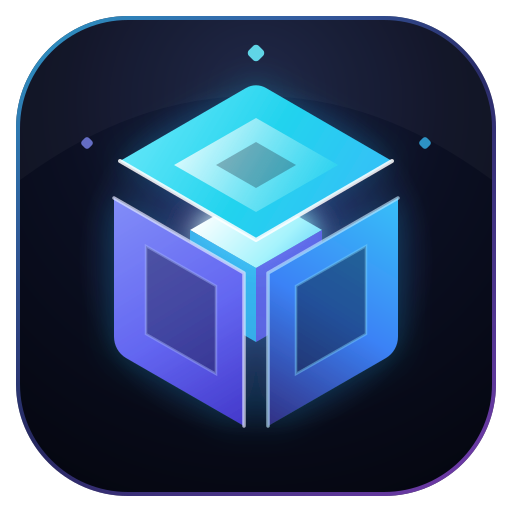

<div align="center">
  
  <h1>LuminaMC Launcher</h1>
  <p><strong>Launcher Minecraft Multiversion Minimaliste & Glassmorphisme</strong></p>
  <p>
    Mods • Shaders • Resource Packs • Datapacks • Modpacks • Modrinth & CurseForge • Skin 3D • Microsoft OAuth2
  </p>
  <p>
    
    
    
    
    
  </p>
</div>

---

## ✨ Fonctionnalités Principales

- **🎮 Multiversion Intégral (`1.0` → `1.21.4` → `26.3+` & Snapshots)**
  - Support natif de toutes les versions officielles Mojang : Releases modernes (`26.3+`, `1.21.x`), versions classiques (`1.7.10`, `1.8.9`, `1.12.2`, `1.0`) et Snapshots.
  - **Flux séparé Téléchargement / Lancement** : Téléchargez d'abord tous les fichiers de l'instance (*Télécharger l'instance*), puis démarrez le jeu instantanément (*Lancer le jeu*).
  - **Support Modloaders** : `Vanilla`, `Fabric`, `NeoForge`, `Forge` et `Quilt`.

- **☕ Gestionnaire Java Automatique (Adoptium Temurin)**
  - Détection et téléchargement automatique en 1 clic de la version exacte de Java requise :
    - **Java 25** pour Minecraft `26.1` / `26.3+`
    - **Java 21 LTS** pour Minecraft `1.20.5` à `1.21.4`
    - **Java 17 LTS** pour Minecraft `1.17` à `1.20.4`
    - **Java 8 Legacy** pour Minecraft `1.0` à `1.16.5` (avec reconstruction automatique des assets virtuels `pre-1.6` et `legacy`).

- **📦 Explorateur Unifié Modrinth & CurseForge**
  - Recherchez, filtrez et installez en 1 clic directement dans vos instances :
    - **Mods** (`.jar`)
    - **Shaders** (`.zip`)
    - **Resource Packs / Packs de Textures** (`.zip`)
    - **Datapacks** (`.zip`)
    - **Modpacks complets** (`.mrpack` Modrinth & archives CurseForge avec création automatique d'instance).

- **🧍 Studio Skin 3D Interactif (`skinview3d`)**
  - Prévisualisation 3D temps réel avec animations (Marche, Course, Repos), cape, modèles `Classic (4px)` et `Slim (3px)`, garde-robe locale, import `.png`, récupération par pseudo et envoi direct vers les serveurs officiels Minecraft.

- **🔐 Authentification Microsoft OAuth2 & Comptes Hors-Ligne**
  - Connexion officielle **Microsoft / Xbox Live / Minecraft Services** ainsi que gestion multi-comptes Hors-Ligne (UUID v3 déterministe).

- **🌌 Design Minimaliste & Glassmorphisme Personnalisable**
  - Interface sombre translucide à flou acrylique (`backdrop-filter`) réglable, 5 thèmes lumineux (*Indigo Aether*, *Cyan Glacial*, *Émeraude Pur*, *Violet Cristal*, *Rose Néon*) et console de logs en temps réel.

---

## 🚀 Installation & Développement

### Prérequis
- [Node.js](https://nodejs.org/) 18+ (ou 20/22 LTS)
- Windows 10/11 (64-bit), macOS ou Linux

### Cloner et lancer en mode développement
```bash
git clone https://github.com/flobure2008-ui/LuminaMC.git
cd LuminaMC
npm install
npm run dev
```

### Lancer en mode production locale
```bash
npm run build
npm start
```
*(Ou double-cliquez sur `Lancer-LuminaMC.bat` sous Windows).*

---

## 📦 Générer l'Installateur Windows (`.exe`)

Pour compiler l'application et générer l'installateur **NSIS (`LuminaMC Setup 1.0.0.exe`)** ainsi que la version **Portable (`LuminaMC-Portable-1.0.0.exe`)** dans le dossier `release/` :

```bash
npm run dist
```
*(Ou double-cliquez sur `Construire-Installateur.bat`).*

---

## 📁 Structure du Projet

```text
lumina-mc-launcher/
├── assets/                  # Icônes d'application (.ico, .png) pour Electron & NSIS
├── electron/
│   ├── main.cjs             # Processus principal Electron (IPC, Mojang/Adoptium, Modrinth/CurseForge, Auth)
│   └── preload.cjs          # Pont sécurisé ContextBridge (window.lumina)
├── public/
│   ├── icon.svg             # Icône vectorielle haute précision
│   └── icon.png             # Icône PNG transparente 512x512
├── src/
│   ├── components/          # Vues React (Instances, Catalogue, Skin 3D, Comptes, Console, Paramètres)
│   ├── services/bridge.ts   # Service TypeScript d'accès à l'API Electron
│   ├── styles/glass.css     # Système de design Glassmorphisme
│   ├── types/launcher.ts    # Modèles de données TypeScript
│   ├── App.tsx              # Coquille principale de l'application
│   └── main.tsx             # Point d'entrée React
├── .github/workflows/       # CI/CD GitHub Actions (Compilation automatique des installateurs)
└── package.json
```

---

## 📄 Licence

Distribué sous licence **MIT**. Voir le fichier [LICENSE](LICENSE) pour plus d'informations.
